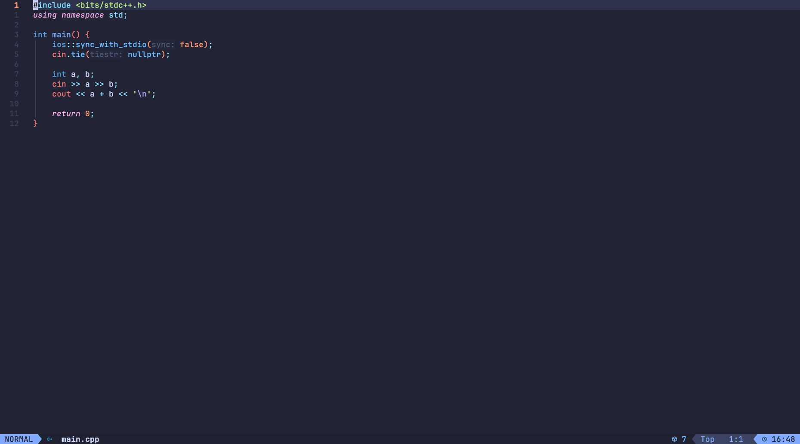

**English** | [한국어](README.ko.md)

# pretest.nvim

A plugin for running testcases and checking the results in Neovim.



## Features

- **Language settings** \
  C++ and Python are supported out of the box; add or modify languages through the `languages` config.
- You can switch the layout between **sidebar** and **floating** at runtime.
- **Competitive Companion integration** \
  Receive a single problem into the current file, create a new file per problem, or generate a whole contest at once.
- **Buffer-aware UI** \
  Moving between source files switches the UI to that file's problem, and per-file results are kept.
- **Safe file moves** \
  `:Pretest rename` / `:Pretest move` carry the `.prob` file and compiled binary along with the source.

## Requirements

- [Neovim](https://neovim.io/) 0.10 or newer
- (Windows) One of `md5`, `openssl`, or `md5sum` on `PATH` \
  If Git for Windows is installed in `C:\Program Files\Git`, add `C:\Program Files\Git\usr\bin` to `PATH`.
- (Optional) A [Nerd Font](https://www.nerdfonts.com/) for the default [empty line marker](docs/configuration.md#empty_line_marker)

## Quick start

Install with [lazy.nvim](https://github.com/folke/lazy.nvim). For other plugin managers, see [Installation](docs/installation.md).

```lua
{
  "skrewbar/pretest.nvim",
  cmd = "Pretest",
  opts = {}, -- see docs/configuration.md
  keys = {
    { "<leader>j", "<cmd>Pretest<cr>", desc = "Pretest" },
  },
}
```

In a source file:

1. `<leader>j` (or `:Pretest`) opens the UI with the cursor in the header. Press `a` (or run `:Pretest add`) to add an empty testcase; the cursor moves to **Input**.
2. Fill in the Input section, move to **Expected** with `<Tab>`, type the expected output, and save with `:w`. To add the next case, press `<C-a>` right there (Normal or Insert mode).
3. Press `<S-CR>` (run all) or `<CR>` (run the current case). Verdicts appear in the header and the program output in **Output**.
4. `<C-n>` / `<C-p>` move between testcases, `?` lists every UI key, and `q` closes the UI. `<leader>j` jumps back to the source.

Instead of typing testcases, you can also run `:Pretest receive` and use Competitive Companion. See [Competitive Companion](docs/competitive-companion.md).

## Documentation

- [Installation](docs/installation.md)
- [Usage](docs/usage.md)
- [Commands](docs/commands.md)
- [Configuration](docs/configuration.md)
- [Competitive Companion](docs/competitive-companion.md)

## `.prob` files

Testcases, the problem name, and limits are stored as JSON in `.pretest/.{filename}_{md5}.prob` next to the source file (or under `save_dir`). The format is compatible with the `.prob` files written by the [Competitive Programming Helper](https://github.com/agrawal-d/cph) VS Code extension, and fields pretest does not use are preserved. See [Usage → Where files are stored](docs/usage.md#where-files-are-stored).

## Related projects

- [CompetiTest.nvim](https://github.com/xeluxee/competitest.nvim)
- [Competitive Programming Helper](https://github.com/agrawal-d/cph)

## License

[Apache License 2.0](LICENSE). See [NOTICE](NOTICE).
